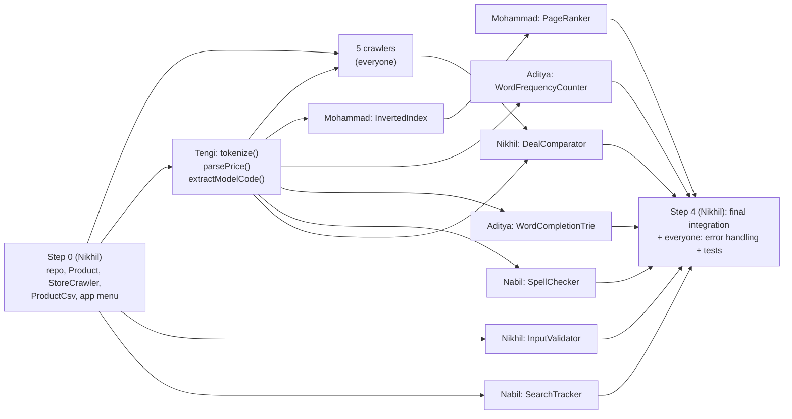

# TechPulse: who does what (Group 7)

These are the assignments from our proposal (section 5.1): each of us builds **one crawler + two features**. The grading
rubric gives full personal marks for "web crawler and two other features with high complexity", plus
separate marks for **error handling in your own features**, and group marks for **testing**,
**data-structure variety** and **integration**. So everyone's code has to plug into the one app; separate
programs lose marks.

All paths below are under `src/main/java/ca/uwindsor/techpulse/` (code) and
`src/test/java/ca/uwindsor/techpulse/` (tests). Every stub already has the method signatures the rest of
the app calls. **Keep those signatures** (name, parameters, return type). You can add private methods,
inner classes and extra files of your own freely.

---

## 1. Your files

### Mohammad Enan Al Harun Sahan
| Feature | File(s) | Data structure (proposal) | Test file |
|---|---|---|---|
| Crawler: Canada Computers | `crawler/CanadaComputersCrawler.java` | BFS: LinkedList queue + HashSet visited | (manual run + screenshots) |
| Inverted indexing | `index/InvertedIndex.java`, `index/Posting.java` | `HashMap<String, List<Posting>>` | `index/InvertedIndexTest.java` |
| Page ranking | `search/PageRanker.java` | score per page + `PriorityQueue` max-heap | `search/PageRankerTest.java` |

### Sheikh MD. Nafis Noor Nabil
| Feature | File(s) | Data structure | Test file |
|---|---|---|---|
| Crawler: PccZone | `crawler/PccZoneCrawler.java` | BFS | |
| Spell checking | `search/SpellChecker.java` | hash set vocabulary + Levenshtein 2D table | `search/SpellCheckerTest.java` |
| Search frequency | `search/SearchTracker.java` | `HashMap` + max-heap top-K | `search/SearchTrackerTest.java` |

### Aditya Mahmud
| Feature | File(s) | Data structure | Test file |
|---|---|---|---|
| Crawler: Vuugo | `crawler/VuugoCrawler.java` | BFS | |
| Word completion | `search/WordCompletionTrie.java` | Trie (`HashMap<Character, TrieNode>`) + DFS | `search/WordCompletionTrieTest.java` |
| Frequency count | `index/WordFrequencyCounter.java` | `HashMap<String,Integer>` per page + sort | `index/WordFrequencyCounterTest.java` |

### Nikhil Mahara
| Feature | File(s) | Data structure | Test file |
|---|---|---|---|
| Crawler: PC-Canada | `crawler/PCCanadaCrawler.java` | BFS (+ Selenium, since the site uses Cloudflare) | |
| Data validation (regex) | `regex/InputValidator.java` | `Pattern` / `Matcher` | `regex/InputValidatorTest.java` |
| Deal comparator | `deals/DealComparator.java` | `HashMap<String, List<Product>>` + min-heap | `deals/DealComparatorTest.java` |
| Integration (shared) | `TechPulseApp.java`, `model/Product.java`, `crawler/StoreCrawler.java`, `storage/ProductCsv.java` | | `storage/ProductCsvTest.java` |

### Tengi Sherpa
| Feature | File(s) | Data structure | Test file |
|---|---|---|---|
| Crawler: IT Hardware Hub | `crawler/ITHubCrawler.java` | BFS | |
| HTML parser | `parser/HtmlParser.java` | Jsoup DOM tree + `ArrayList` tokens | `parser/HtmlParserTest.java` |
| Finding patterns (regex) | `regex/PatternExtractor.java` | `Pattern` with capturing groups | `regex/PatternExtractorTest.java` |

> File names changed from the proposal: `Vuugo.java` → `VuugoCrawler.java` and `ITHub.java` →
> `ITHubCrawler.java` (so all crawlers are named the same way). Use the new names in the report.

---

## 2. The shared contract (what connects everyone)

**`Product`** (`model/Product.java`) is the one data shape everybody uses:

| Field | Example | Notes |
|---|---|---|
| `store` | `pc-canada` | same as your crawler's `storeName()` |
| `title` | `MSI GeForce RTX 4070 Ventus 2X 12GB` | |
| `category` | `GPU` | one of GPU / CPU / RAM / SSD |
| `modelNumber` | `RTX-4070` | from `PatternExtractor.extractModelCode(title)`, `""` if none |
| `price` | `749.99` | from `PatternExtractor.parsePrice(text)`, `-1` if unreadable |
| `inStock` | `true` | |
| `url` | `https://...` | product page link; acts as the page ID for frequency count |
| `description` | `""` | optional extra text from the product page |

**CSV files:** each crawler's results are saved by the app to `data/products/<storeName>.csv` with the header
`store,title,category,modelNumber,price,inStock,url,description`. The app loads every CSV in that folder at start-up.
Commit your store's CSV, so that teammates can test with real data without crawling.

**Assignment 1 data:** if your Assignment 1 CSV has the products of your store, you can convert it to this header
(Excel: rearrange/add columns → Save As CSV UTF-8) and drop it in `data/products/` to get real data on day one.

**Text → words:** every feature that needs words uses `HtmlParser.tokenize(product.getSearchText())`, so the
index, trie, spell checker and frequency counter all agree on what a "word" is.

---

## 3. Order of work and dependencies

| Step | Who | What | Waits for |
|---|---|---|---|
| 0 | Nikhil | Repo, `pom.xml`, `Product`, `StoreCrawler`, `ProductCsv`, menu in `TechPulseApp`, sample data | nothing (**done in the starter repo**) |
| 1 | **Tengi, first** | `HtmlParser.tokenize`, `PatternExtractor.parsePrice` and `extractModelCode`. Push them as a small PR quickly | nothing |
| 1 | Everyone | Your crawler: find the category URLs, inspect the product cards, BFS + polite delay + save raw HTML | `parsePrice`/`extractModelCode` to fill price/model (until then, put `-1` / `""`) |
| 1 | Nikhil | `InputValidator` | nothing |
| 1 | Nabil | `SearchTracker` | nothing |
| 2 | Mohammad | `InvertedIndex` | `tokenize` |
| 2 | Aditya | `WordCompletionTrie`, `WordFrequencyCounter` | `tokenize` |
| 2 | Nabil | `SpellChecker` | `tokenize` (vocabulary) |
| 3 | Mohammad | `PageRanker` | `InvertedIndex` |
| 3 | Nikhil | `DealComparator` | `extractModelCode` + at least 2 store CSVs with the same parts (sample data works meanwhile) |
| 4 | Nikhil | Final wiring/polish of `TechPulseApp`, demo script | all features merged |
| 4 | Everyone | Error handling review + JUnit tests for your features | your features |

**Not blocked while you wait:** until `tokenize` is merged, write your feature against a temporary
`text.toLowerCase().split("[^a-z0-9-]+")` *inside your own test* (not inside your class), and switch to the real
one when it lands. Everyone can work on their crawler from day one.

---

## 4. How the app uses your code (search flow)

1. User types a query → `InputValidator.isValidKeyword` (Nikhil). Bad input → message, ask again.
2. `SearchTracker.record(query)` (Nabil).
3. Query → `HtmlParser.tokenize` (Tengi).
4. Each word not in the vocabulary → `SpellChecker.suggest(word, 2)` → "Did you mean …?" (Nabil).
5. `PageRanker.topPages(words, 10)` (Mohammad) using `InvertedIndex.lookup` (Mohammad) → ranked products.
6. Other menu options: word completion (Aditya), top searches (Nabil), word frequency on a page (Aditya),
   cheapest store for a model (Nikhil), re-crawl all stores (everyone's crawlers).

All of this is already written in `TechPulseApp.java`. As soon as your stub returns real results, they show up in the menu.

---

## 5. Timeline (approx. Adjust to our real Week 11 class date; presenting in Week 11 gives +1 bonus)

| Dates | Goal |
|---|---|
| Oct 29 – Nov 4 | Everyone cloned and running it. Tengi's tokenize/regex merged. Each crawler fetches at least 1 category page. InputValidator + SearchTracker done |
| Nov 5 – Nov 11 | All crawlers save CSVs into `data/products/`. Index, trie, frequency, spell checker done. PageRanker + DealComparator on real data |
| Nov 12 – Nov 18 | Everything merged and working together in the menu. Error handling pass. JUnit tests for every feature |
| Nov 19 → presentation | Report (contributions + file names, data structures per feature, screenshots), slides, live demo rehearsal (**7–10 min**; points lost outside that) |

---

## 6. Rules

- **Only edit files with your name as OWNER.** Shared files go through Nikhil (or a PR everyone sees).
- One branch per feature, PR into `main` (see README §5). Pull `main` into your branch every few days.
- **Write your own code.** The course runs plagiarism checks. Code from online, from teammates, or AI-generated
  code you don't understand all count against you, and in the Q&A each of us gets asked about *our own* files.
- **Reusing your own Assignment 2 code is encouraged** where it matches your feature (e.g. AVL tree, cuckoo
  hashing, merge sort, heap sort). Different structures across features earn the "data structure variety" marks.
- Comment your code (short comments on *why*). Marks are deducted for missing comments.
- Don't commit huge files: raw HTML goes in `data/raw/`, which Git ignores.

## 7. "Done" checklist for each feature

- [ ] Works on the real crawled CSVs, not only the sample
- [ ] Handles bad input without crashing: null/empty strings, unknown words/URLs, network errors (crawlers), no results
- [ ] JUnit tests in your test file: normal cases + edge cases (all green in the Testing panel)
- [ ] Comments + the data structure and time complexity written in the class comment (needed for the report)
- [ ] Merged into `main` through a PR, and the app still starts
- [ ] Screenshot(s) of your feature in the console for the report
